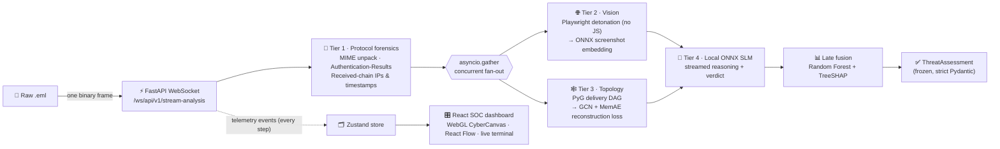

<div align="center">

# 🛡️ Sentinel-Graph

### Multimodal AI-Assisted Phishing & Threat Intelligence Detection

-00ff66?style=for-the-badge&logo=pytest&logoColor=white)


**B.E. Information Technology — Capstone Project**<br/>
Developed by **Uday Babasaheb Baviskar** · JSPM Jayawantrao Sawant College of Engineering

</div>

---

Sentinel-Graph analyses a raw email (`.eml`) the way a Security Operations Centre analyst would, but in seconds: it verifies the sender cryptographically, models the delivery route as a graph and scores it for anomalies, detonates the lure in a sandboxed browser, asks a **local** language model to reason about the evidence, fuses everything into one risk score, and **explains that score feature by feature** with SHAP. Every step streams live to a WebGL dashboard over a WebSocket.

> [!IMPORTANT]
> **Model status (read before quoting results).** Not every engine ships with trained weights. The table below is what the deployed system actually runs, and the API reports the same flags on every analysis (`model_status`) so the dashboard can label stand-in scores.
>
> | Engine | State | Notes |
> |---|---|---|
> | Topology MemAE | ✅ Trained | SpamAssassin 2002 corpus, benign routes only; zero-day threshold calibrated (0.913) |
> | Fusion meta-model | ✅ Trained | 5-fold stratified OOF ROC-AUC **0.855** (see [Results](#-results)) |
> | Vision (MobileNetV3 slot) | ⚠️ Placeholder | Untrained stand-in with the real I/O contract until a model is placed in `models/vision/` |
> | Cognitive SLM (Phi-3 slot) | ⚠️ Scripted stand-in | Real onnxruntime-genai path is implemented; activates when Phi-3 ONNX artifacts are installed |

---

## 📑 Contents

[Architecture](#-architecture) · [Core innovations](#-core-innovations) · [Security engineering](#-security-engineering) · [Results](#-results) · [Local deployment](#-local-deployment) · [Training](#-training-the-models) · [Testing](#-testing) · [Configuration](#-configuration) · [Repository layout](#-repository-layout) · [Limitations](#-limitations--future-work) · [References](#-references)

---

## 🧱 Architecture



| Stage | Module | What it produces |
|---|---|---|
| MIME unpacking | `src/extractors/mime_parser.py` | Text/HTML bodies and attachments from hostile MIME (malformed boundaries, lying charsets, recursion bombs) |
| URL extraction | `src/extractors/url_extractor.py` | Browser-equivalent URLs (zero-width / bidi / backslash obfuscation removed) |
| Identity | `src/forensics/auth_analyzer.py` | SPF / DKIM / DMARC / ARC verdicts, sender domains, display-name brand spoofing |
| Route | `src/forensics/route_analyzer.py` | Hop count, private-IP leak between public hops, timestamp regression |
| Sandbox | `src/vision/sandbox.py` + `egress_proxy.py` | 1024×768 screenshot of the lure, rendered with JavaScript disabled |
| Vision | `src/vision/brand_detector.py` | SHA-256, L2-normalised embedding, `VisionForensics` |
| Topology | `src/topology/graph_builder.py`, `memae_model.py` | Delivery DAG, MemAE anomaly loss, zero-day flag |
| Reasoning | `src/cognitive/prompt_engineer.py`, `slm_inference.py` | Injection-hardened prompt, streamed deduction, extracted verdict |
| Fusion | `src/fusion/meta_scorer.py`, `xai_engine.py` | Phishing probability and exact per-feature SHAP attribution |
| Streaming | `src/core/orchestrator.py`, `app/main.py` | The fan-out pipeline and the WebSocket API |

Measured end-to-end on a laptop CPU (real Chromium, trained MemAE and fusion model): Tier 1 done at **~60 ms**, topology scored at **~90 ms** (concurrently with detonation), detonation **~2.5 s**, complete assessment **~4 s**.

---

## 💡 Core innovations

### 🕸️ Delivery topology as a graph, scored by a memory-augmented autoencoder

A phishing kit can rewrite every word of its message, but it still has to *deliver* it, and the delivery leaves structure behind: which relays touched it, in what order, through which address spaces, with what clock behaviour. Flat text models (TF-IDF, bag-of-words, even sentence embeddings) discard that relational structure. Sentinel-Graph keeps it:

1. **Graph.** Each email becomes a DAG — sender → relay hops → receiver, plus sender → each URL — with node features `x ∈ ℝ^{N×5}` (one-hot node type ‖ path position or URL character entropy).
2. **Encoder.** Two GCN layers (5 → 32 → 16) propagate `H' = σ(D̂^{-½} Â D̂^{-½} H W)` so each node's latent vector `z_i` reflects its neighbourhood.
3. **Memory addressing.** A learned memory `M ∈ ℝ^{50×16}` stores prototypes of *normal* routing. Each latent addresses it by cosine similarity and a sharpened softmax, `w_i = softmax(cos(z_i, M) / τ)` with `τ = 0.1`.
4. **Hard shrinkage.** `ŵ = ReLU(w − λ)·w / (|w − λ| + ε)` with `λ = 0.05`, then L1 re-normalisation: each node must be rebuilt from a **sparse** mix of a few normal prototypes.
5. **Decoder and score.** `ẑ = ŵ M`, `Â_pred = σ(ẑ ẑᵀ)`; the anomaly score is the off-diagonal binary cross-entropy against the real (undirected) adjacency.

**Why the memory matters (the mathematical advantage).** A plain autoencoder generalises *too well*: it learns to reconstruct anomalies too, so their error stays low. Forcing reconstruction through a small memory of benign prototypes means an unseen topology simply cannot be expressed, and its loss rises (Gong et al., 2019). MemAE trains on **benign mail only**, so it needs no labelled examples of the attack — the property that lets it flag *zero-day* routing tricks a supervised classifier has never seen. The zero-day threshold is the 99th percentile of benign losses measured **out of fold** (0.913).

### 🧠 Local ONNX small language model, not a cloud API

- **Data never leaves the host.** Emails carry personal data; nothing is sent to a third-party model provider, which keeps the system inside data-protection obligations such as India's DPDP Act, 2023.
- **Deterministic.** Greedy decoding: the same evidence yields the same deduction, so verdicts are reproducible for audit.
- **Streamed.** Tokens reach the analyst as they are generated, through the same WebSocket as the telemetry.
- **Injection-hardened.** Attacker text cannot forge template sections, `VERDICT:` lines or chat-role tokens; and the extracted verdict can **escalate but never downgrade** when outputs conflict.
- **One voice, not the judge.** The SLM verdict is one of ten fusion features; the final score is the meta-model's, explained by SHAP.

### 📊 Explainable late fusion

Ten features from every tier feed a Random Forest. **TreeSHAP** gives exact additive attributions — base value + Σ SHAP = predicted probability (verified in the test suite to 10⁻⁶) — reported per feature and per subsystem (`PROTOCOL_FORENSICS`, `VISION_ENGINE`, `TOPOLOGY_GNN`, `COGNITIVE_SLM`). The dashboard colours graph edges by the sign of their subsystem's SHAP impact.

---

## 🔒 Security engineering

| Threat | Defence |
|---|---|
| Malformed MIME, recursion bombs, lying charsets | Defect harvesting, depth/part limits, headers-only fallback, charset fallback chain; never raises |
| Forged `Authentication-Results` | Only the trusted authserv-id (or topmost) header counts; comments and quoted strings are blanked; duplicates resolve to the most suspicious result |
| Display-name brand spoofing | NFKC + homoglyph + zero-width + leetspeak folding, token-aligned matching, canonical sender domains that exclude free-mail |
| Sandbox SSRF (`http://169.254.169.254/`) | Every Chromium connection — including redirect hops, which Playwright's routing never sees — goes through a loopback egress proxy that connects only to vetted public IPs (defeats DNS rebinding) |
| Malicious downloads / heavy media | Route interception blocks executables, archives and media; downloads refused; JavaScript disabled; Chromium OS sandbox on |
| Prompt injection | Payload and telemetry folded to one line; template markers and chat tokens neutralised |
| Model-file tampering | Torch checkpoints load with `weights_only=True`; joblib/pickle files must live in a trusted `MODELS_DIR` |
| Cross-site WebSocket hijacking | `Origin` checked against `SOC_CORS_ALLOW_ORIGINS` (CORS does not cover WebSockets) |

---

## 📈 Results

Trained on the **SpamAssassin public corpus (2002)**: 2,551 ham, 501 spam.

| Metric | Value |
|---|---|
| Out-of-fold ROC-AUC (5-fold stratified) | **0.855** |
| Ham precision / recall | 0.902 / 0.946 |
| Spam precision / recall (threshold 0.5) | 0.634 / 0.477 |
| Accuracy | 0.869 |
| MemAE zero-day threshold (99th pct. of OOF benign loss) | 0.913 |
| Full training run (CPU) | ~5 min |

**Leakage controls** (the reason these numbers can be trusted):

- **Out-of-fold only.** Every reported prediction comes from a model that never saw that email.
- **Cross-fitted MemAE.** Each email's MemAE loss comes from a MemAE trained on the *other* folds' benign mail.
- **No label leak through the SLM.** The SLM verdict was deliberately held constant during training: mapping ham→BENIGN and spam→CRITICAL would have produced a meaningless AUC of 1.0.

**What the numbers do not show.** The 2002 corpus predates DMARC (no `Authentication-Results` headers), and vision and the SLM could not run per training email. Those five features were constant, so the model learned only from routing, display-name and topology signals, and it under-scores modern phishing (a 2026-style Apple lure scores ≈ 5/100). Retraining on a modern labelled corpus is the first item of future work.

---

## 🚀 Local deployment

### Requirements

| | Minimum | Tested |
|---|---|---|
| Python | 3.12 | 3.14.6 |
| Node.js | 20.19 / 22.12 (Vite 8) | 24.22 LTS |
| CPU / RAM | 4 cores, 8 GB | Windows 11 laptop, CPU only |
| Disk | ~3 GB (PyTorch, Chromium, models) | — |

All engines run on **CPU** out of the box (ONNX Runtime `CPUExecutionProvider`). A GPU only matters once a real SLM is installed: Phi-3-mini-4k-instruct int4 needs ~2.5 GB of model files and ~4 GB of RAM or VRAM; it runs on CPU, and a consumer GPU such as an **NVIDIA RTX 3050 (4–8 GB VRAM)** with the CUDA or DirectML build of `onnxruntime-genai` streams it markedly faster.

### 1 · Backend

```bash
python -m pip install -e ".[dev]"
```

```bash
python -m playwright install chromium
```

```bash
uvicorn app.main:app --host 127.0.0.1 --port 8000
```

On first start, missing models are generated as clearly-flagged placeholders (`GET /api/v1/health` lists them). Train real ones with the next section.

### 2 · Frontend

```bash
cd frontend
```

```bash
npm install
```

```bash
npm run dev
```

Open **http://localhost:5173** and drop an `.eml` file onto the dashboard. Vite proxies `/api` and `/ws` to the backend on port 8000.

### 3 · Optional: real SLM

Install `onnxruntime-genai` (CPU, CUDA or DirectML build) and copy a Phi-3-mini ONNX folder — the one containing `genai_config.json` — to `models/phi3/`. On the next start `CognitiveSLM` loads it instead of the stand-in.

---

## 🎓 Training the models

```bash
python scripts/train_orchestrator.py --debug-slice 100
```

Expects `data/raw/spamassassin/{easy_ham,spam}/` (from `20021010_easy_ham.tar.bz2` and `20021010_spam.tar.bz2` at spamassassin.apache.org/old/publiccorpus). Omit `--debug-slice` for the full corpus. Writes `models/fusion_meta.joblib`, `models/topology/memae.pt`, a self-verified `memae.onnx`, and `models/training_report.json`.

---

## 🧪 Testing

```bash
python -m pytest
```

241 tests: unit, property and adversarial cases for every tier, real-Chromium sandbox tests, training-pipeline tests, and `tests/e2e/` — whole-system runs through the WebSocket API with real engine loading. `python -m pytest -m "not e2e"` skips the slower end-to-end tests; `SOC_LIVE_NETWORK_TESTS=1` adds a live internet detonation. Static checks:

```bash
python -m mypy src tests scripts app
```

```bash
npm --prefix frontend run build
```

---

## 🔧 Configuration

All settings are environment variables with the `SOC_` prefix (or a `.env` file).

| Variable | Default | Purpose |
|---|---|---|
| `SOC_MODELS_DIR` | `./models` | Where every engine loads (or generates) its model |
| `SOC_LOG_DIR` | `./logs` | NDJSON log for SIEM ingestion (`system.log`) |
| `SOC_TRUSTED_AUTHSERV_IDS` | `[]` | Your MX's authserv-id(s); set this in production |
| `SOC_CORS_ALLOW_ORIGINS` | `["*"]` | Browser origins allowed to call the API |
| `SOC_SANDBOX_TIMEOUT_MS` | `4000` | Navigation budget per detonation |
| `SOC_SANDBOX_CHROMIUM_OS_SANDBOX` | `true` | Disable only where Chromium's sandbox cannot start |
| `SOC_MAX_EMAIL_BYTES` | `16777216` | Largest email the API accepts |

---

## 📁 Repository layout

```text
app/                 FastAPI app: ConnectionManager + WebSocket endpoint
src/core/            settings, JSON logging, orchestrator, shared helpers
src/extractors/      MIME unpacker, URL extractor
src/forensics/       identity (auth + spoofing) and route analysers
src/vision/          Playwright sandbox, egress proxy, ONNX brand detector
src/topology/        PyG graph builder, GraphMemAE
src/cognitive/       prompt builder, local SLM streaming + verdict extraction
src/fusion/          meta-scorer, SHAP engine
scripts/             train_orchestrator.py (lazy ingestion, cross-fitting, OOF CV)
tests/               241 tests, including tests/e2e/
frontend/            React 19 + Vite + Tailwind + Three.js + React Flow dashboard
```

---

## 🧭 Limitations & future work

- **Modern training data.** Retrain on a labelled 2020s corpus with `Authentication-Results` headers, and run vision and the SLM during training so their features carry signal.
- **Monotonic fusion.** Constrain spoofing, IP-leak and regression features to only *raise* risk (e.g. `HistGradientBoostingClassifier` with monotonic constraints) so out-of-distribution mail cannot invert them.
- **Real vision model** and brand centroids for `visual_spoof_score`; credential-form detection for `is_credential_harvester`.
- **Throughput.** Pre-warmed browser pool, URL-result cache, and a job queue in front of the sandbox.
- **Contracts.** Generate the TypeScript types from the Pydantic JSON schema; add CI so the test badge is live.

---

## 📚 References

1. D. Gong et al., "Memorizing Normality to Detect Anomaly: Memory-augmented Deep Autoencoder for Unsupervised Anomaly Detection," *ICCV*, 2019.
2. T. N. Kipf and M. Welling, "Semi-Supervised Classification with Graph Convolutional Networks," *ICLR*, 2017.
3. S. M. Lundberg and S.-I. Lee, "A Unified Approach to Interpreting Model Predictions," *NeurIPS*, 2017.
4. S. M. Lundberg et al., "From local explanations to global understanding with explainable AI for trees," *Nature Machine Intelligence*, 2020.
5. M. Kucherawy, "Message Header Field for Indicating Message Authentication Status," RFC 8601, 2019.

---

<div align="center">

Released under the [MIT License](LICENSE) · © 2026 Uday Babasaheb Baviskar

</div>
