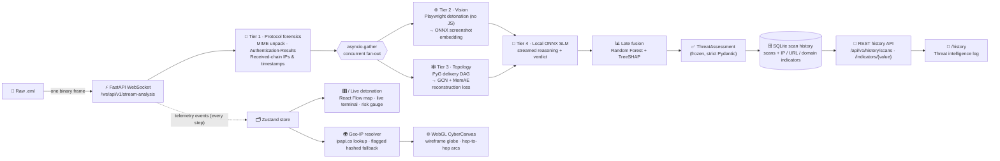

<div align="center">

# 🛡️ Sentinel-Graph (SOC v2)

### Multimodal AI-Assisted Phishing & Threat Intelligence Detection

-00ff66?style=for-the-badge&logo=pytest&logoColor=white)


**B.E. Information Technology — Capstone Project**<br/>
Developed by **Uday Babasaheb Baviskar** · JSPM Jayawantrao Sawant College of Engineering

</div>

---

Sentinel-Graph analyses a raw email (`.eml`) the way a Security Operations Centre analyst would, but in seconds: it verifies the sender cryptographically, models the delivery route as a graph and scores it for anomalies, detonates the lure in a sandboxed browser, asks a **local** language model to reason about the evidence, fuses everything into one risk score, and **explains that score feature by feature** with SHAP. Every step streams live to a WebGL dashboard over a WebSocket; every verdict is saved with its indicators (IPs, URLs, sender domains) so an analyst can pivot from one indicator to every scan that saw it, and the delivery route is drawn hop by hop on a 3D globe.

> [!IMPORTANT]
> **Model status (read before quoting results).** Not every engine ships with trained weights. The table below is what the deployed system actually runs, and the API reports the same flags on every analysis (`model_status`) so the dashboard can label stand-in scores.
>
> | Engine | State | Notes |
> |---|---|---|
> | Topology MemAE | ✅ Trained | SpamAssassin 2002 corpus, benign routes only; zero-day threshold calibrated (0.913) |
> | Fusion meta-model | ✅ Trained | 5-fold stratified OOF ROC-AUC **0.855** (see [Results](#-results)) |
> | Vision (MobileNetV3 slot) | ⚠️ Placeholder | Untrained stand-in with the real I/O contract until a model is placed in `models/vision/` |
> | Cognitive SLM (Phi-3 slot) | ⚠️ Scripted stand-in | Real onnxruntime-genai path is implemented; activates when Phi-3 ONNX artifacts are installed. The stand-in always answers `CRITICAL`, and that verdict is what history records, so benign mail shows as CRITICAL until a real SLM is installed |
> | Globe hop locations | ⚠️ Partly estimated | Public IPs are looked up; any hop that cannot be located is placed at a hashed stand-in position, drawn dashed and counted on the risk gauge |

---

## 📑 Contents

[Architecture](#-architecture) · [Core innovations](#-core-innovations) · [Security engineering](#-security-engineering) · [Results](#-results) · [Local deployment](#-local-deployment) · [Training](#-training-the-models) · [Testing](#-testing) · [Configuration](#-configuration) · [Repository layout](#-repository-layout) · [Limitations](#-limitations--future-work) · [References](#-references)

---

## 🧱 Architecture



Tier 1 runs first because every later tier needs its output (bodies, URLs, route); vision and topology then run concurrently. The canvas and the analysis socket live in the app shell outside React Router's routes, so switching between the live view and the history log never tears down the WebGL context or a scan in flight.

| Stage | Module | What it produces |
|---|---|---|
| MIME unpacking | `src/extractors/mime_parser.py` | Text/HTML bodies and attachments from hostile MIME (malformed boundaries, lying charsets, recursion bombs) |
| URL extraction | `src/extractors/url_extractor.py` | Browser-equivalent URLs (zero-width / bidi / backslash obfuscation removed) |
| Identity | `src/forensics/auth_analyzer.py` | SPF / DKIM / DMARC / ARC verdicts, sender domains, display-name brand spoofing |
| Route | `src/forensics/route_analyzer.py` | Hop count, private-IP leak between public hops, timestamp regression |
| Sandbox | `src/vision/sandbox.py` + `egress_proxy.py` | 1024×768 screenshot of the lure, rendered with JavaScript disabled |
| Vision | `src/vision/brand_detector.py` | SHA-256, L2-normalised embedding, `VisionForensics` |
| Topology | `src/topology/graph_builder.py`, `memae_model.py` | Delivery DAG, MemAE anomaly loss, zero-day flag |
| Reasoning | `src/cognitive/prompt_engineer.py`, `slm_inference.py` | Injection-hardened prompt, streamed deduction, extracted verdict |
| Fusion | `src/fusion/meta_scorer.py`, `xai_engine.py` | Phishing probability and exact per-feature SHAP attribution |
| Streaming | `src/core/orchestrator.py`, `app/main.py` | The fan-out pipeline and the WebSocket API |
| Persistence | `src/core/database.py`, `src/models/db_models.py` | Async SQLAlchemy scan records and pivotable indicators |
| History | `src/api/routers/history.py` | Paginated scan log and indicator pivot endpoints |
| Dashboard | `frontend/src/pages/`, `components/CyberCanvas.tsx`, `lib/geoResolver.ts` | Live and history pages, globe, hop geolocation |

Measured end-to-end on a laptop CPU (real Chromium, trained MemAE and fusion model): Tier 1 done at **~60 ms**, topology scored at **~90 ms** (concurrently with detonation), detonation **~2.5 s**, complete assessment **~4 s**.

---

## 💡 Core innovations

### 🕸️ Delivery topology as a graph, scored by a memory-augmented autoencoder

A phishing kit can rewrite every word of its message, but it still has to *deliver* it, and the delivery leaves structure behind: which relays touched it, in what order, through which address spaces, with what clock behaviour. Flat text models (TF-IDF, bag-of-words, even sentence embeddings) discard that relational structure. Sentinel-Graph keeps it:

1. **Graph.** Each email becomes a DAG — sender → relay hops → receiver, plus sender → each URL — with node features `x ∈ ℝ^{N×5}` (one-hot node type ‖ path position or URL character entropy).
2. **Encoder.** Two GCN layers (5 → 32 → 16) propagate `H' = σ(D̂^{-½} Â D̂^{-½} H W)` so each node's latent vector `z_i` reflects its neighbourhood.
3. **Memory addressing.** A learned memory `M ∈ ℝ^{50×16}` stores prototypes of *normal* routing. Each latent addresses it by cosine similarity and a sharpened softmax, `w_i = softmax(cos(z_i, M) / τ)` with `τ = 0.1`.
4. **Hard shrinkage.** `ŵ = ReLU(w − λ)·w / (|w − λ| + ε)` with `λ = 0.05`, then L1 re-normalisation: each node must be rebuilt from a **sparse** mix of a few normal prototypes.
5. **Decoder and score.** `ẑ = ŵ M`, `Â_pred = σ(ẑ ẑᵀ)`; the anomaly score is the off-diagonal binary cross-entropy against the real (undirected) adjacency.

**Why the memory matters (the mathematical advantage).** A plain autoencoder generalises *too well*: it learns to reconstruct anomalies too, so their error stays low. Forcing reconstruction through a small memory of benign prototypes means an unseen topology simply cannot be expressed, and its loss rises (Gong et al., 2019). MemAE trains on **benign mail only**, so it needs no labelled examples of the attack — the property that lets it flag *zero-day* routing tricks a supervised classifier has never seen. The zero-day threshold is the 99th percentile of benign losses measured **out of fold** (0.913).

**What it can see today.** Route nodes carry only their type and position along the path; IP semantics (private range, ASN, reverse-DNS agreement, per-hop clock deltas) are separate fusion features, not node features. The trained MemAE therefore models the *shape* of delivery — route length and link profile — and enriching node features with per-hop attributes is the step that lets it see forged hops directly (see [Results](#-results)).

### 🧠 Local ONNX small language model, not a cloud API

- **Data never leaves the host.** Emails carry personal data; nothing is sent to a third-party model provider, which keeps the system inside data-protection obligations such as India's DPDP Act, 2023.
- **Deterministic.** Greedy decoding: the same evidence yields the same deduction, so verdicts are reproducible for audit.
- **Streamed.** Tokens reach the analyst as they are generated, through the same WebSocket as the telemetry.
- **Injection-hardened.** Attacker text cannot forge template sections, `VERDICT:` lines or chat-role tokens; and the extracted verdict can **escalate but never downgrade** when outputs conflict.
- **One voice, not the judge.** The SLM verdict is one of ten fusion features; the final score is the meta-model's, explained by SHAP.

### 📊 Explainable late fusion

Ten features from every tier feed a Random Forest. **TreeSHAP** gives exact additive attributions — base value + Σ SHAP = predicted probability (verified in the test suite to 10⁻⁶) — reported per feature and per subsystem (`PROTOCOL_FORENSICS`, `VISION_ENGINE`, `TOPOLOGY_GNN`, `COGNITIVE_SLM`). The dashboard colours graph edges by the sign of their subsystem's SHAP impact.

### ✂️ Receiver-side hop normalisation

`Received` headers are written by both sides of a delivery. The hops the *receiving* provider adds after accepting a message — Gmail's `by`-only hand-offs, a content filter on loopback, internal relays — describe the recipient's mailbox, not the sender. Left in, they let a model learn *which mailbox a training email came from* (a corpus artefact) instead of whether it is phishing. The route analyser walks the chain newest first and strips every hop whose receiving host and verified reverse-DNS name sit in the receiver's own registered domain, keeping the receiver's **entry hop**: its client IP is the last address the sender side presented. HELO names are never trusted, because the sender writes them. Every route feature — hop count, private-IP leak, timestamp regression, the DAG itself, the stored IP indicators — is computed on the sender-side path only.

### 🌍 Resilient, privacy-aware Geo-IP mapping

The globe needs a latitude and longitude for each hop, and a live demo cannot depend on a free API's rate limit. `resolveIPsToCoords` looks up public hop IPs at ipapi.co in parallel (4 s timeout, cached per session) and never rejects: on a network or CORS error, an HTTP 429, ipapi's `200 {"error": true}` or a timeout, the IP is hashed with 32-bit FNV-1a (two independent seeds) into a stable point, `lat = (h₁ mod 18001)/100 − 90`, `lng = (h₂ mod 36000)/100 − 180`. The same IP always lands in the same place, so repeated demos are reproducible.

- **Honest by construction.** Each point is tagged `lookup` or `estimated`; estimated arcs are dashed and the risk gauge reports how many hop locations are stand-ins. An estimate is never presented as where a host is.
- **Privacy-aware.** Private, reserved and malformed addresses are never sent anywhere. `VITE_GEO_LOOKUP=off` keeps every IP on the machine (all points estimated), matching the local-only stance of the SLM.
- **Race-safe.** Coordinates are stored only if no newer scan has started while the lookups were in flight.

---

## 🔒 Security engineering

| Threat | Defence |
|---|---|
| Malformed MIME, recursion bombs, lying charsets | Defect harvesting, depth/part limits, headers-only fallback, charset fallback chain; never raises |
| Forged `Authentication-Results` | Only the trusted authserv-id (or topmost) header counts; comments and quoted strings are blanked; duplicates resolve to the most suspicious result |
| Display-name brand spoofing | NFKC + homoglyph + zero-width + leetspeak folding, token-aligned matching, canonical sender domains that exclude free-mail |
| Sandbox SSRF (`http://169.254.169.254/`) | Every Chromium connection — including redirect hops, which Playwright's routing never sees — goes through a loopback egress proxy that connects only to vetted public IPs (defeats DNS rebinding) |
| Malicious downloads / heavy media | Route interception blocks executables, archives and media; downloads refused; JavaScript disabled; Chromium OS sandbox on |
| Prompt injection | Payload and telemetry folded to one line; template markers and chat tokens neutralised |
| Model-file tampering | Torch checkpoints load with `weights_only=True`; joblib/pickle files must live in a trusted `MODELS_DIR` |
| Cross-site WebSocket hijacking | `Origin` checked against `SOC_CORS_ALLOW_ORIGINS` (CORS does not cover WebSockets) |
| Cross-origin reads of scan history | CORS defaults to the Vite dev origins, never `*`: history exposes subjects, senders and analyst traces |
| Indicator leakage to third parties | Geo lookups skip private/reserved IPs; `VITE_GEO_LOOKUP=off` disables them entirely |

---

## 📈 Results

Trained on the **SpamAssassin public corpus (2002)**: 2,551 ham, 501 spam.

| Metric | Value |
|---|---|
| Out-of-fold ROC-AUC (5-fold stratified) | **0.855** |
| Ham precision / recall | 0.902 / 0.946 |
| Spam precision / recall (threshold 0.5) | 0.634 / 0.477 |
| Accuracy | 0.869 |
| MemAE zero-day threshold (99th pct. of OOF benign loss) | 0.913 |
| Full training run (CPU) | ~5 min |

**Leakage controls** (the reason these numbers can be trusted):

- **Out-of-fold only.** Every reported prediction comes from a model that never saw that email.
- **Cross-fitted MemAE.** Each email's MemAE loss comes from a MemAE trained on the *other* folds' benign mail.
- **No label leak through the SLM.** The SLM verdict was deliberately held constant during training: mapping ham→BENIGN and spam→CRITICAL would have produced a meaningless AUC of 1.0.

**What the numbers do not show.** The 2002 corpus predates DMARC (no `Authentication-Results` headers), and vision and the SLM could not run per training email. Those five features were constant, so the model learned only from routing, display-name and topology signals, and it under-scores modern phishing. Retraining on a modern labelled corpus is the first item of future work.

**Measured on the demo lure** (`tests/e2e/test_capstone_defense.py -s`, trained models): a 2026-style Apple lure with SPF/DMARC failures, a private hop between public relays and a backwards clock scores **15/100**. Its SHAP breakdown shows why: `private_ip_leak` pushes the probability **down** (−0.129) and `timestamp_regression` up (+0.083). The cause is measured, not guessed: **two-thirds of SpamAssassin's legitimate mail is mailing-list traffic** (Red Hat's `exmh-workers`, `xent.com`, SourceForge lists), which genuinely travels sender → corporate internal relays (172.16.x, 192.168.x) → public list server. In the research corpus `private_ip_leak` fires on 66.8% of legitimate mail and 3.0% of phishing, so the forest learned "private hop = mailing list = safe" — exactly what the monotonic constraints below would forbid. The trained MemAE scores this forged 3-hop route at a loss of **0.0003** (very normal) yet a benign single-hop email with one link at **0.96**, above the zero-day threshold: it learned the route lengths of 2002 ham, not forgery (see *What it can see today*, above).

### Candidate models: era-matched research corpus (in `models_research/`, not deployed)

Trained on 4,211 legitimate (SpamAssassin 2002–03) and 2,361 phishing (Nazario 2004–06) emails, 5-fold stratified, MemAE cross-fitted as above.

| Out of fold | Value |
|---|---|
| ROC-AUC | **0.926** |
| Phishing precision / recall / F1 at 0.5 | 0.772 / 0.875 / **0.820** |
| Legitimate precision / recall | 0.924 / 0.855 |
| Accuracy | 0.862 |
| MemAE zero-day threshold (99th pct. OOF benign loss) | 1.10 |

**On mail neither model was trained on** — 1,000 Nazario phishing emails from 2023–25 — the candidate catches **48.8%** at 0.5 (deployed: 41.1%) and scores the demo lure **55/100** (deployed: 15). Recall falls from 87.5% in-distribution to 48.8% twenty years later: the cross-validated AUC describes 2004–06 phishing, not today's. There is no modern legitimate mail to measure the out-of-time false-positive rate; the benign demo email rises from 14 to 29.

**What the candidate still gets wrong.** `private_ip_leak` is more strongly inverted (SHAP −0.312 on the demo lure) because the mailing-list confound above is in this corpus too; `display_name_spoof_risk` now carries real weight (+0.352) and the MemAE pushes the lure's risk up (+0.035, loss 0.194). Five features are still constant in training (no `Authentication-Results` in either source; vision and the SLM held fixed), so the model cannot use them.

**Two training bugs the loss curves exposed.** The first research run had two folds diverge at epoch 4 (training loss 0.18 → 2.14), inflating the zero-day threshold to 4.79. Clipping gradients alone made it worse — a fold climbed to 10.8 and the threshold sat at 27.78 ≈ −ln(10⁻¹²), the ceiling of the old clamped loss. The real fault: `reconstruction_loss` clamped sigmoid probabilities before BCE, which has **zero gradient once saturated**, so a drifting model could never recover. It now computes BCE on logits (identical where unsaturated — the deployed MemAE scores the demo lure exactly as before — but always differentiable), and all five folds converge (0.25 → 0.11–0.14, validation 0.09–0.16).

---

## 🚀 Local deployment

### Requirements

| | Minimum | Tested |
|---|---|---|
| Python | 3.12 | 3.14.6 |
| Node.js | 20.19 / 22.12 (Vite 8) | 24.22 LTS |
| CPU / RAM | 4 cores, 8 GB | Windows 11 laptop, CPU only |
| Disk | ~3 GB (PyTorch, Chromium, models) | — |

All engines run on **CPU** out of the box (ONNX Runtime `CPUExecutionProvider`). A GPU only matters once a real SLM is installed: Phi-3-mini-4k-instruct int4 needs ~2.5 GB of model files and ~4 GB of RAM or VRAM; it runs on CPU, and a consumer GPU such as an **NVIDIA RTX 3050 (4–8 GB VRAM)** with the CUDA or DirectML build of `onnxruntime-genai` streams it markedly faster.

### 1 · Backend

```bash
python -m pip install -e ".[dev]"
```

```bash
python -m playwright install chromium
```

```bash
uvicorn app.main:app --host 127.0.0.1 --port 8000
```

On first start, missing models are generated as clearly-flagged placeholders (`GET /api/v1/health` lists them). Train real ones with the next section.

### 2 · Frontend

```bash
cd frontend
```

```bash
npm install
```

```bash
npm run dev
```

Open **http://localhost:5173** and drop an `.eml` file onto the dashboard. Vite proxies `/api` and `/ws` to the backend on port 8000. The sidebar switches between **Live detonation** (`/`) and **Threat history** (`/history`); a scan keeps streaming while you browse the history log.

To keep every hop IP on the machine during a demo, put `VITE_GEO_LOOKUP=off` in `frontend/.env.local` before `npm run dev` (globe positions are then all estimated and labelled as such).

### 3 · Optional: real SLM

Install `onnxruntime-genai` (CPU, CUDA or DirectML build) and copy a Phi-3-mini ONNX folder — the one containing `genai_config.json` — to `models/phi3/`. On the next start `CognitiveSLM` loads it instead of the stand-in.

---

## 🎓 Training the models

The trainer reads any folder of labelled `.eml` files: `benign/` + `phishing/`, or SpamAssassin's `easy_ham/` + `spam/`. **Candidates go to `models_research/` by default**, never straight to the `models/` the app loads, so a run cannot replace working models before it has been compared. Each run writes `fusion_meta.joblib`, `topology/memae.pt`, a self-verified `memae.onnx`, `training_report.json` (out-of-fold ROC-AUC, phishing precision / recall / F1 at 0.5, per-fold MemAE loss history), `roc_auc_curve.png` and `training_loss.png` (MemAE training vs held-out benign loss per epoch; each fold validates on its own held-out benign mail, so the curve costs no extra data).

**Research corpus (default `--data-dir`, `data/raw/research/`).** Era-matched public mail with intact `Received` chains: SpamAssassin's easy and hard ham (2002–03) against Jose Nazario's early phishing mailboxes (2004–07, CC-BY-4.0), deduplicated by Message-ID and content hash, with attribution written alongside (~85 MB of downloads):

```bash
python scripts/fetch_modern_corpus.py research
```

```bash
python scripts/train_orchestrator.py
```

Enron is deliberately not used: its public release strips `Received` headers, so every benign email would have no route and the route models would learn "has headers" instead of phishing. Real phishing archives trip antivirus; on Windows, Defender quarantines `phishing3.mbox` (2006–07), and the fetch skips a quarantined mailbox and says so rather than failing (the corpus is then 4,211 benign / 2,361 phishing). Do not disable the scanner to get it back; if you want it, exclude only `data\raw\downloads\nazario` and `data\raw\research`.

**Promote a candidate** only after comparing it with the deployed models; `--models-dir models` trains straight into the folder the app loads:

```bash
python scripts/train_orchestrator.py --models-dir models
```

**Shipped models (2002 SpamAssassin baseline).** Extract `20021010_easy_ham.tar.bz2` and `20021010_spam.tar.bz2` into `data/raw/spamassassin/`, then pass `--data-dir data/raw/spamassassin`. Retraining will not reproduce the shipped weights exactly: MemAE training now clips gradients and computes its loss on logits (see Results).

**Modern corpus (`data/raw/modern_2026/`).** Hand-classified 2023–25 phishing from the same Nazario archive. No public archive of modern legitimate mail keeps full routing headers, so the benign half comes from an mbox you export yourself:

```bash
python scripts/fetch_modern_corpus.py real --limit 1000 --benign-mbox path/to/inbox.mbox
```

`fetch_modern_corpus.py synthetic` writes a separate, clearly-labelled smoke-test corpus to `data/raw/synthetic_2026/`; it exercises the pipeline but never feeds training, because a model trained on generated mail learns the generator. Add `--debug-slice 100` to any training run for a quick check.

---

## 🧪 Testing

```bash
python -m pytest
```

310 tests: unit, property and adversarial cases for every tier, real-Chromium sandbox tests, training-pipeline tests, history API and persistence tests, and `tests/e2e/` — whole-system runs through the WebSocket API with real engine loading. `tests/e2e/test_capstone_defense.py` runs the **deployed** models (skipped until a training run exists) from ingestion to the history API; add `-s` to print the trained model's SHAP breakdown for the demo lure. `python -m pytest -m "not e2e"` skips the slower end-to-end tests; `SOC_LIVE_NETWORK_TESTS=1` adds a live internet detonation. Static checks:

```bash
python -m mypy src tests scripts app
```

```bash
npm --prefix frontend run build
```

---

## 🔧 Configuration

All settings are environment variables with the `SOC_` prefix (or a `.env` file).

| Variable | Default | Purpose |
|---|---|---|
| `SOC_MODELS_DIR` | `./models` | Where every engine loads (or generates) its model |
| `SOC_LOG_DIR` | `./logs` | NDJSON log for SIEM ingestion (`system.log`) |
| `SOC_TRUSTED_AUTHSERV_IDS` | `[]` | Your MX's authserv-id(s); set this in production |
| `SOC_CORS_ALLOW_ORIGINS` | the Vite dev origins (`:5173`) | Browser origins allowed to call the API and stream (`["*"]` allows any) |
| `SOC_DATABASE_URL` | `sqlite+aiosqlite:///<project>/soc_intel.db` | Scan history database |
| `SOC_SANDBOX_TIMEOUT_MS` | `4000` | Navigation budget per detonation |
| `SOC_SANDBOX_CHROMIUM_OS_SANDBOX` | `true` | Disable only where Chromium's sandbox cannot start |
| `SOC_MAX_EMAIL_BYTES` | `16777216` | Largest email the API accepts |
| `VITE_GEO_LOOKUP` (frontend, `frontend/.env.local`) | on | `off` never sends hop IPs to ipapi.co; globe positions are then all estimated |

---

## 📁 Repository layout

```text
app/                 FastAPI app: ConnectionManager + WebSocket endpoint
src/api/routers/     REST history API (scans, indicator pivots)
src/core/            settings, JSON logging, orchestrator, database, shared helpers
src/models/          SQLAlchemy scan and indicator tables
src/extractors/      MIME unpacker, URL extractor
src/forensics/       identity (auth + spoofing) and route analysers
src/vision/          Playwright sandbox, egress proxy, ONNX brand detector
src/topology/        PyG graph builder, GraphMemAE
src/cognitive/       prompt builder, local SLM streaming + verdict extraction
src/fusion/          meta-scorer, SHAP engine
scripts/             train_orchestrator.py (lazy ingestion, cross-fitting, OOF CV),
                     fetch_modern_corpus.py (research: SpamAssassin 2002-03 ham + Nazario 2004-07;
                     real: Nazario 2023-25 + your benign mbox; synthetic smoke tests)
tests/               310 tests, including tests/e2e/
frontend/            React 19 + Vite + Tailwind + Three.js + React Flow dashboard
  src/pages/         LiveDetonation (/) and ThreatHistory (/history)
docs/                CAPSTONE_PRESENTATION.md (12-min talk), CAPSTONE_DEFENSE.md (5-min talk + Q&A)
```

---

## 🧭 Limitations & future work

- **Modern training data.** Retrain on a labelled 2020s corpus with `Authentication-Results` headers, and run vision and the SLM during training so their features carry signal.
- **Monotonic fusion.** Constrain spoofing, IP-leak and regression features to only *raise* risk (e.g. `HistGradientBoostingClassifier` with monotonic constraints) so out-of-distribution mail cannot invert them — as `private_ip_leak` currently is on the demo lure.
- **Richer graph nodes.** Give each hop node its own attributes (private/bogon flag, ASN change from the previous hop, clock delta, reverse-DNS agreement) so the MemAE can see a forged hop rather than only the route's shape.
- **Benign mail for the modern corpus.** The phishing half of `data/raw/modern_2026/` is in place; a consented, exported benign mailbox completes it.
- **Real vision model** and brand centroids for `visual_spoof_score`; credential-form detection for `is_credential_harvester`.
- **Throughput.** Pre-warmed browser pool, URL-result cache, and a job queue in front of the sandbox.
- **Contracts.** Generate the TypeScript types from the Pydantic JSON schema; add CI so the test badge is live.

---

## 📚 References

1. D. Gong et al., "Memorizing Normality to Detect Anomaly: Memory-augmented Deep Autoencoder for Unsupervised Anomaly Detection," *ICCV*, 2019.
2. T. N. Kipf and M. Welling, "Semi-Supervised Classification with Graph Convolutional Networks," *ICLR*, 2017.
3. S. M. Lundberg and S.-I. Lee, "A Unified Approach to Interpreting Model Predictions," *NeurIPS*, 2017.
4. S. M. Lundberg et al., "From local explanations to global understanding with explainable AI for trees," *Nature Machine Intelligence*, 2020.
5. M. Kucherawy, "Message Header Field for Indicating Message Authentication Status," RFC 8601, 2019.

---

<div align="center">

Released under the [MIT License](LICENSE) · © 2026 Uday Babasaheb Baviskar

</div>
